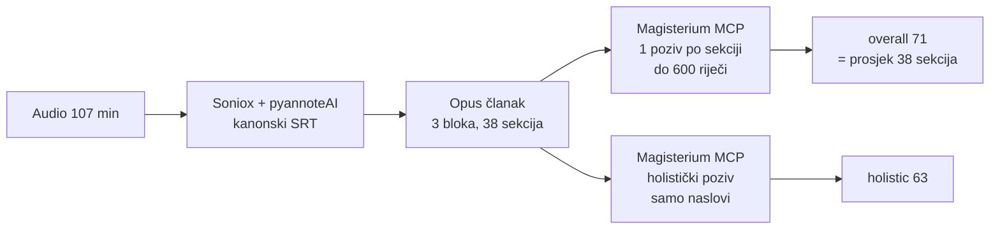
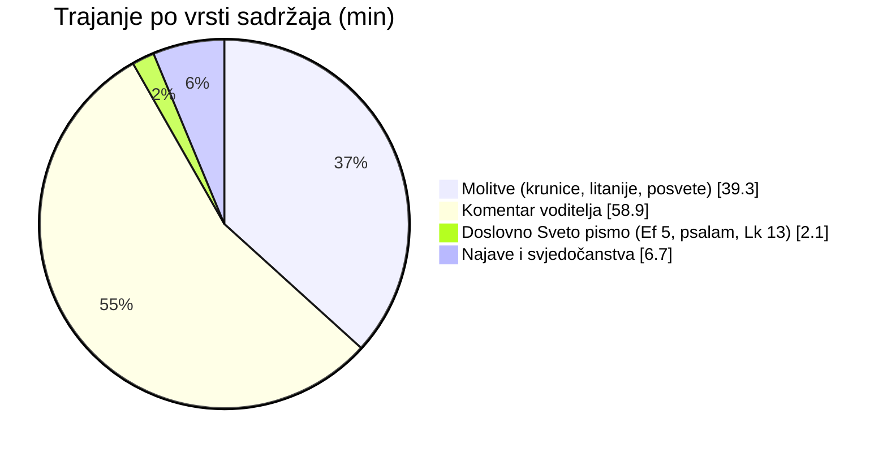
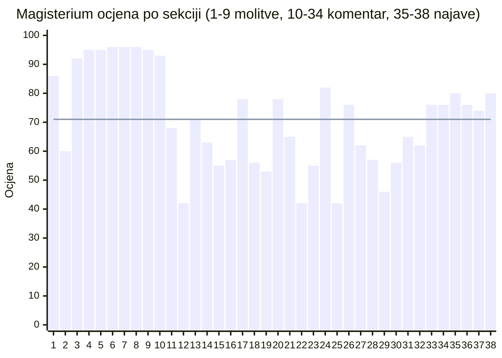
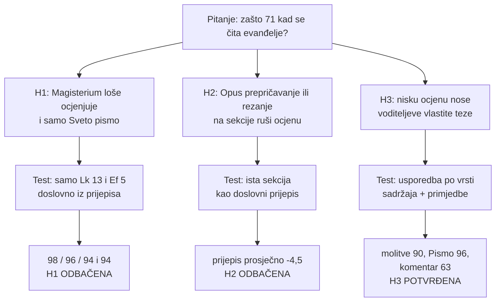
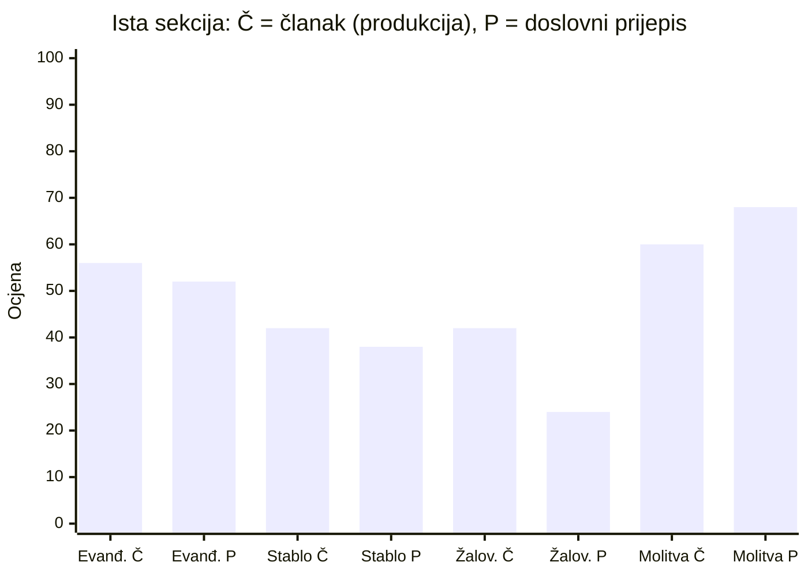
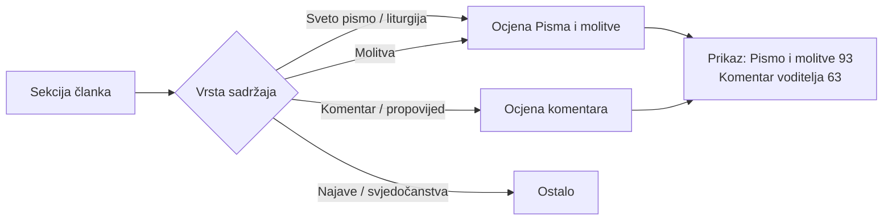

# Magisterium ocjena epizode koja čita evanđelje dana

**Epizoda:** Ora et labora, 120 „Milosrđe Božje – Kako raste kraljevstvo Božje?”
(YouTube `nBPDxzrAW0Q`, 26.10.2026., 1 h 47 min)
**Produkcijska ocjena (27.10.2026.):** overall **71** („uglavnom usklađeno”), holistička **63**,
38 sekcija, 102 primjedbe
**Analiza:** 28.10.2026., 10 dodatnih poziva Magisterium MCP-a + mjerenja s diska

## Sažetak

1. **Tekst evanđelja dobiva 94–98** kad se pošalje sam, uz isti prompt kao u produkciji.
   Problem nije u Svetom pismu.
2. **Epizoda je većinom laički komentar, ne čitanje.** Sveto pismo traje oko 2 od 107 minuta,
   molitve 39 minuta (prosjek 90), a voditeljev komentar 61 minutu (prosjek 63). Svih 11
   sekcija ispod 60 nalazi se u komentaru.
3. **Pipeline ne snižava ocjenu.** Doslovni prijepis ocijenjen je u prosjeku 4,5 boda
   strože od Opusova članka. Hipoteza „šaljemo dio teksta pa nema konteksta” ne drži.
4. **Šum mjerenja je ±8 bodova po sekciji.** Pojedinačne razlike manje od toga ne treba
   tumačiti.
5. **Dvije stvari su naš propust u mjerenju**, ne problem sadržaja:
   - jedan broj miješa tekst Crkve i osobne teze voditelja;
   - holistička ocjena vidi samo naslove sekcija.

## 1. Kako ocjena nastaje



- Svaka sekcija ide u poseban poziv s istim promptom (`magisterium_mcp_prep.js:buildBatchPrompt`).
  Prompt sadrži naziv bloka, podnaslov, ključne pojmove i do 600 riječi sadržaja članka.
- **Root `overall_score` je obični prosjek sekcija**, bez težine po trajanju.
  Molitva od 16 minuta i komentar od 50 sekundi vrijede jednako.
- Skala u promptu je **90–100 = „aktivno promiče i produbljuje katolički nauk”**. Goli
  citat zato po definiciji teško doseže 100, jer ništa ne „produbljuje”.

## 2. Od čega se epizoda sastoji



| Dio | Trajanje | Sekcija | Prosjek | Najniža | Sekcija < 60 |
|---|---|---|---|---|---|
| Molitve | 39,3 min (37 %) | 9 | **90,1** | 60 | 0 |
| Komentar voditelja (+ čitanja unutar njega) | 61,0 min (57 %) | 25 | **63,0** | 42 | **11** |
| Najave i svjedočanstva | 6,7 min (6 %) | 4 | 77,5 | 74 | 0 |
| **Ukupno** | 107 min | 38 | **71,0** | | 11 |

Vremenski ponderiran prosjek je **74,9**. Duge molitve bi s težinom po trajanju nosile više.

### Ocjena po sekcijama kroz epizodu



Crta je prosjek 71. Prijelom je oštar: molitve su na 92–96, a od sekcije 11 (početak
voditeljeva tumačenja) ocjene padaju u raspon 42–82.

### Kontekst kataloga

| | Vrijednost |
|---|---|
| Epizoda s Magisteriumom na disku | 425 |
| Overall p10 / p25 / medijan / p75 / p90 | 75 / 81 / **88** / 94 / 96 |
| Ova epizoda | **71**, oko 8. percentila |
| Sekcija < 60, cijeli katalog (8 565 sekcija) | 2,8 % |
| Sekcija < 60, ova epizoda | **29 %** (11 / 38) |
| Usporedba: `muzevni_budite` (71 ep.), `catholic_futurist` (17 ep.) | prosjek 93 / 92 |

Katolički podcasti u katalogu redovito dobivaju 90+, pa niska ocjena nije sustavna
pristranost Magisteriuma prema vjerskom sadržaju.

## 3. Pokus: isti prompt, drukčiji ulaz

Svi pozivi su išli istim produkcijskim promptom (batch-of-1, ista skala) i istim
MCP klijentom (`tools/magisterium_mcp_client.js`). Mijenjan je samo sadržaj sekcije.
10 poziva, 471 s, 0 neuspjelih.



### 3.1 Samo Sveto pismo

| Ulaz | Riječi | Ocjena |
|---|---|---|
| Lk 13,18-21 (evanđelje dana), doslovno | 70 | **98** |
| isto, 2. ponavljanje | 70 | **96** |
| isto, 3. ponavljanje | 70 | **94** |
| Ef 5,21-33 (prvo čitanje), doslovno | 168 | **94** |

Prosjek za evanđelje je **96,0** (raspon 94–98). Jedina primjedba na Ef 5: „žene muževima
u svemu” treba čitati zajedno s pozivom na uzajamnu podložnost. To je standardna
katolička napomena uz taj tekst, a ne prigovor čitaču.

### 3.2 Članak (Opus) vs doslovni prijepis, i ponovljivost

| Sekcija | Produkcija (članak) | Članak, ponovljeno | Doslovni prijepis | Prijepis − produkcija |
|---|---|---|---|---|
| 30 · 01:30:10 evanđelje + tumačenje prispodoba | 56 | 64 | 52 | −4 |
| 12 · 00:46:11 predbračni odnosi, „generacijsko stablo” | 42 | 42 | 38 | −4 |
| 22 · 01:13:05 žalovanje za nekršćaninom | 42 | — | **24** | −18 |
| 2 · 00:00:25 molitva oslobođenja | 60 | — | 68 | +8 |
| **Prosjek** | | | | **−4,5** |



- **Ponovljivost:** identičan ulaz dao je 56 → 64 i 42 → 42. Srednja apsolutna razlika je
  4, najveća 8. Razlike od nekoliko bodova između sekcija su šum.
- **Smjer učinka članka:** u 3 od 4 slučaja prijepis je ocijenjen strože. Opus u članku
  uokviruje sporne tvrdnje („prema njegovu tumačenju”, „tvrdi voditelj”) i izostavlja
  dio oštrih formulacija iz govora (npr. „perverzije”). Članak
  dakle **ublažava**, a ne izobličuje.
- Iznimka je molitva oslobođenja (+8). Doslovni tekst sadrži i molitvu sv. Mihaelu, koju
  Magisterium prepoznaje kao odobrenu, a članak je samo prepričava. Razlika je unutar šuma.

## 4. Dvostruko gledanje: gdje Magisterium ima pravo, a gdje je strog

Za svaku nisko ocijenjenu cjelinu navedena su oba pogleda. Pogled A je primjedba
Magisteriuma i izvor nauka. Pogled B je ono što ide u prilog voditelju ili ukazuje na
ograničenje mjerenja.

### 4.1 Sekcija 12 · „Generacijsko stablo” (42 / ponovljeno 42 / prijepis 38)

- **A:** tvrdi se da promiskuitet „u konačnici vodi do homoseksualnosti” i da se
  sklonost prenosi na unuke zbog grijeha djeda i bake. KKC 2357 kaže da psihološki nastanak
  sklonosti „ostaje uglavnom neobjašnjen”, a Crkva razlikuje sklonost (nije grijeh) od čina.
- **B:** voditelj u istoj cjelini izričito poručuje „ne osuditi, nego navijestiti lijek”,
  što Magisterium i priznaje. Nauk o spolnosti kao takav (odnos pripada braku) iznesen je
  točno.
- **Presuda:** primjedba je utemeljena. Ocjena je stabilna u tri mjerenja (42/42/38).

### 4.2 Sekcija 25 · „Ti si u zabludi” i mješoviti brakovi (42)

- **A:** „da bi primili sakrament vjenčanja, oboje trebaju biti katolici” je **činjenično
  netočno**, jer je brak dvoje krštenih sakrament i kad jedan nije katolik (KKC 1633–1637).
  Tvrdnja da se mješoviti brakovi „u pravilu raspadaju vrlo brzo” nema izvor.
- **B:** voditelj sam navodi da postoje iznimke i govori iz osobnog iskustva („nisam čuo za
  suprotan slučaj”). Crkva doista upozorava na teškoće mješovitih brakova.
- **Presuda:** utemeljeno, jer sadrži jednu provjerljivu netočnost.

### 4.3 Sekcija 22 · Žalovanje za nekršćaninom (42 / prijepis 24)

- **A:** prijekor „kako se Boga ne bojiš… bio si prijatelj s nekim tko nije kršćanin” u
  sukobu je sa zapovijedi ljubavi prema bližnjemu. Isus je plakao za Lazarom.
- **B:** jezgra prigovora je da javno žalovanje za slavnom osobom bude veće nego na Veliki
  petak. To je legitimna pastoralna opaska o prioritetima.
- **Presuda:** utemeljeno. Doslovni prijepis je strože ocijenjen (24) jer u govoru ima više
  takvih formulacija nego u članku.

### 4.4 Sekcija 2 · Molitva oslobođenja (60 / prijepis 68)

- **A:** „u ime Isusovo uzimam vlast i vežem” i „zapovijedam silama zla da odstupe” je
  imperativna formula. Obrednik egzorcizma i pismo Kongregacije za nauk vjere *Inde ab aliquot
  annis* (1985.) traže da je vjernici laici ne izgovaraju.
- **B:** molitva je i molba Bogu, zaziva Marijin zagovor i sv. Mihaela, a takve molitve
  oslobođenja raširene su u karizmatskim zajednicama. Magisterium sam kaže da je „uglavnom
  usmjerena na kršćansku molitvu zaštite”.
- **Presuda:** djelomično utemeljeno. Primjedba se odnosi na formu (tko smije zapovijedati),
  ne na sadržaj vjere.

### 4.5 Sekcija 30 · Evanđelje dana i tumačenje prispodoba (56 / 64 / 52)

- **A:** voditelj kaže da prispodobe ne razumiju „sinovi tame… pomračenog, racionalnog i
  strogo ortodoksnog duha”. Katolički nauk ne suprotstavlja vjeru razumu, a „strogu
  pravovjernost” ne izjednačava s tamom.
- **B:** tekst evanđelja unutar iste sekcije je ispravan, i sam po sebi dobiva 96. Ocjena
  sekcije miješa citat i tumačenje, pa „evanđelje dobilo 56” na prvi pogled izgleda kao
  kazna za Sveto pismo, a nije.
- **Presuda:** primjedba je utemeljena na tumačenju. **Ovdje je mjerni problem naš**: jedna
  sekcija sadrži dvije različite vrste sadržaja.

### 4.6 Gdje je Magisterium prestrog (pogled B prevladava)

Magisterium neke homiletske slike čita kao egzegetske tvrdnje. Primjeri iz sekcije 34 (76):

- „ptice = anđeli i sveti”: označeno kao „nije utvrđeno iz teksta”. To je propovjednička
  primjena, a takve su česte i kod otaca.
- „Isus je 30 godina radio s Josipom u radionici”: označeno kao detalj koji evanđelja ne
  navode. To je uobičajena pobožna formulacija.
- „kvasac preko noći, Bog radi s tijestom”: označeno kao „nije u tekstu”.

Te primjedbe nose po nekoliko bodova u sekcijama koje su doktrinarno ispravne (raspon
62–78). Nisu uzrok najnižih ocjena, ali spuštaju prosjek komentara.

## 5. Ograničenja mjerenja (u našem pipelineu)

| # | Ograničenje | Učinak na ovu epizodu |
|---|---|---|
| 1 | Overall je obični prosjek sekcija, bez težine po trajanju | 71 umjesto 74,9 |
| 2 | Jedan broj miješa liturgijski tekst, molitve i osobne teze voditelja | „Evanđelje = 56” je pogrešan dojam |
| 3 | Holistički prompt šalje samo teme i podnaslove, ne sadržaj | 63 temeljen na naslovima poput „Predbračni odnosi i mijenjanje partnera” |
| 4 | Prompt ne kaže žanr (propovijed / homiletska primjena) | Nekoliko bodova po sekciji na slikovitim primjenama (4.6) |
| 5 | Polje `Podcast:` u promptu nosi ime datoteke, ne naslov epizode | Model ne zna da je riječ o emisiji „evanđelje dana” |
| 6 | Šum ±8 po sekciji; pokus ima malo ponavljanja (n = 2–3) | Zaključci o smjeru vrijede, pojedinačni bodovi ne |

## 6. Prijedlozi (ništa nije implementirano)



1. **Ocjena po vrsti sadržaja.** Svakoj sekciji dodati oznaku vrste (Opus je može dati
   već u outlineu) i prikazivati dva ili tri broja umjesto jednog. Za ovu epizodu to bi bilo
   „Sveto pismo i molitve ≈ 93 · komentar voditelja 63”. To je objektivnije i prema
   kanalu i prema čitatelju.
2. **Odvojiti citat od tumačenja.** Kad sekcija sadrži doslovno čitanje (evanđelje,
   poslanica), čitanje je zasebna sekcija. Tada „evanđelje” ne nosi ocjenu tumačenja.
3. **Žanr u promptu.** Dodati rečenicu poput: „Ovo je homiletska primjena laika. Ocjenjuj
   doktrinarne tvrdnje, slikovite primjene ne tretiraj kao egzegezu.” Očekivani učinak je
   nekoliko bodova u sekcijama tipa 4.6. Utemeljene primjedbe (4.1–4.3) ostale bi.
4. **Pravi naslov epizode** u polju `Podcast:` (fallback na naslov iz `.info.json`).
5. **Holistički poziv sa sažetkom svakog bloka**, ne samo naslovima.

Prije uvođenja 3. i 5. treba ponoviti ovaj pokus na istim sekcijama (oko 10 poziva) i
usporediti s brojkama iz ovog izvještaja.

## Prilog A · Sve sekcije

M = molitve, K = komentar voditelja, N = najave i svjedočanstva. „Prim.” je broj primjedbi.

| # | Vrijeme | Vrsta | Min | Ocjena | Prim. | Podnaslov |
|---|---|---|---|---|---|---|
| 1 | 00:00:05 | M | 0.3 | 86 | 0 | Zrno koje postaje stablo: poziv na zajedničku molitvu |
| 2 | 00:00:25 | M | 1.6 | 60 | 4 | Molitva oslobođenja: vezanje zlih sila i zaštita Kristove krvi |
| 3 | 00:01:58 | M | 0.7 | 92 | 1 | Vojvoda nebeske vojske i molitva za srce koje kuca s Isusovim |
| 4 | 00:02:40 | M | 2.8 | 95 | 1 | Dvostruka posveta: Bezgrešnom Srcu Marijinu i Presvetom Srcu Isusovu |
| 5 | 00:05:30 | M | 8.1 | 95 | 1 | Krunica Božjega milosrđa: „Po njegovoj pregorkoj muci“ |
| 6 | 00:13:35 | M | 4.1 | 96 | 0 | Litanije Božjem milosrđu: od stvaranja svijeta do duša u čistilištu |
| 7 | 00:17:42 | M | 15.7 | 96 | 0 | Gospina krunica: od krvavog znoja do bičevanja i trnove krune |
| 8 | 00:33:22 | M | 4.1 | 96 | 0 | Križni put do Golgote: nošenje križa i raspeće |
| 9 | 00:37:30 | M | 1.9 | 95 | 0 | „Zdravo Kraljice“ i prijelaz na tumačenje svete riječi |
| 10 | 00:39:24 | K | 3.3 | 93 | 2 | „Otajstvo je to veliko“: brak kao zrcalo odnosa Krista i Crkve |
| 11 | 00:42:40 | K | 3.5 | 68 | 4 | Jedno tijelo i jedan duh: od bračnog čina do slike Presvetog Trojstva |
| 12 | 00:46:11 | K | 3.4 | 42 | 4 | Predbračni odnosi i „mijenjanje partnera“ |
| 13 | 00:49:32 | K | 4.7 | 71 | 4 | „Blago svakome koji se boji Gospodina“ i opasnost obljutavljene soli |
| 14 | 00:54:12 | K | 4.2 | 63 | 3 | Anegdota s doškolovanja: pitanje o toleranciji |
| 15 | 00:58:27 | K | 1.7 | 55 | 4 | Podijeljene zbornice i kako opstati na radnom mjestu |
| 16 | 01:00:08 | K | 3.2 | 57 | 3 | Strah Božji nije strah od kazne |
| 17 | 01:03:18 | K | 1.6 | 78 | 2 | Kad se djeca okrenu od vjere |
| 18 | 01:04:54 | K | 2.8 | 56 | 4 | „Odlazite od mene, bezakonici“ |
| 19 | 01:07:44 | K | 3.4 | 53 | 4 | Što je grijeh uči Sveto pismo, a ne zakonodavci |
| 20 | 01:11:08 | K | 1.2 | 78 | 3 | Slavljenje bez suprotstavljanja zlu |
| 21 | 01:12:20 | K | 0.8 | 65 | 2 | „Gle koliko ljudi nije spašeno zbog tvoje šutnje“ |
| 22 | 01:13:05 | K | 1.9 | 42 | 3 | Više žalosti za slavnim pjevačem nego na Veliki petak |
| 23 | 01:15:00 | K | 3.7 | 55 | 3 | „Bili smo prijatelji“: prijateljstvo koje obvezuje na navještaj |
| 24 | 01:18:40 | K | 1.8 | 82 | 3 | Jedna rečenica na poslovnom ručku i primjer Majke Tereze |
| 25 | 01:20:30 | K | 3.7 | 42 | 4 | „Ti si u zabludi“ i teškoće mješovitih brakova |
| 26 | 01:24:10 | K | 0.9 | 76 | 3 | Isusove posljednje riječi kao zapovijed |
| 27 | 01:25:05 | K | 1.8 | 62 | 4 | „Idite po svem svijetu“: vjera i krštenje kao uvjet spasenja |
| 28 | 01:26:50 | K | 1.7 | 57 | 4 | „Kršćanstvo je samo jedna od ponuda“ i samoizopćenje heretika |
| 29 | 01:28:30 | K | 1.7 | 46 | 4 | Koncerti u korizmi, žalovanje dijela klera, farizeji |
| 30 | 01:30:10 | K | 1.1 | 56 | 4 | Evanđelje dana i dva razloga zašto Isus govori u prispodobama |
| 31 | 01:31:15 | K | 4.0 | 65 | 4 | Kontrolabilnost kao grijeh lažnog katoličanstva |
| 32 | 01:35:15 | K | 1.1 | 62 | 3 | Pravi brat pomaže, lažni vreba |
| 33 | 01:36:20 | K | 1.7 | 76 | 4 | Egzorcizam nad samim sobom |
| 34 | 01:38:00 | K | 2.4 | 76 | 4 | Gorušičino zrno i kvasac |
| 35 | 01:40:25 | N | 2.3 | 80 | 1 | Turneja promocija knjige „Isus lider“ |
| 36 | 01:42:45 | N | 0.8 | 76 | 2 | Članstvo u Ora et labora |
| 37 | 01:43:30 | N | 1.7 | 74 | 4 | Svjedočanstva o ozdravljenjima |
| 38 | 01:45:10 | N | 1.9 | 80 | 2 | Poziv muškarcima na trgove, blagoslov |

## Prilog B · Reprodukcija

```
D=storage/output/ora_et_labora
B=20261026_120_milosrde_bozje_kako_raste_kraljevstvo_bozje_yt_nBPDxzrAW0Q
node experiments/2026-10-28-magisterium-evandjelje/build_job.js \
  --dir $D --base $B --out $D/${B}_magisterium_analiza
node tools/magisterium_mcp_client.js run \
  --job $D/${B}_magisterium_analiza/analiza.job.json \
  --results-dir $D/${B}_magisterium_analiza/results
```

Datoteke u ovoj mapi:

- `prompts/`: točni promptovi;
- `results/`: sirovi MCP odgovori (`holistic` = 3. ponavljanje evanđelja);
- `rezultati.json`: parsirane ocjene i primjedbe;
- `client.log`: dnevnik poziva.

Magisterium je pozivan isključivo preko MCP-a (Pro pretplata), bez API ključa.
